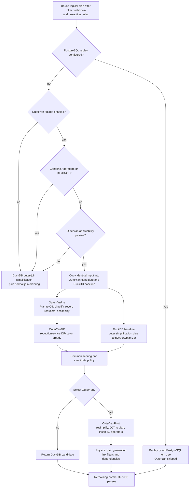
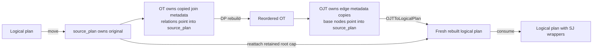
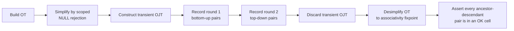
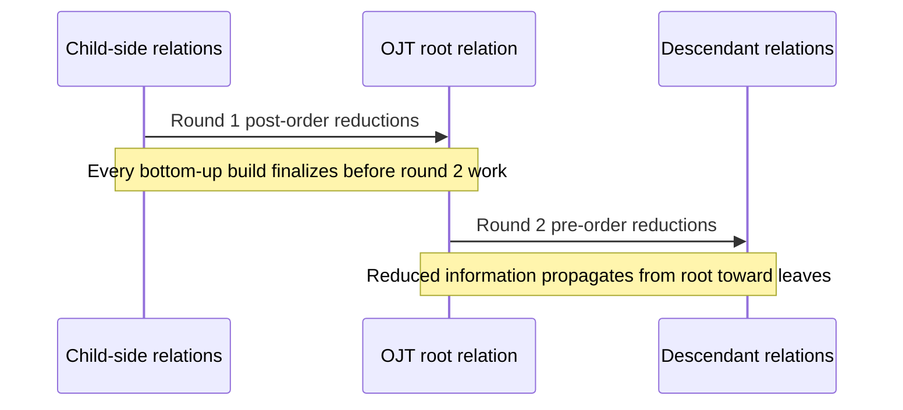
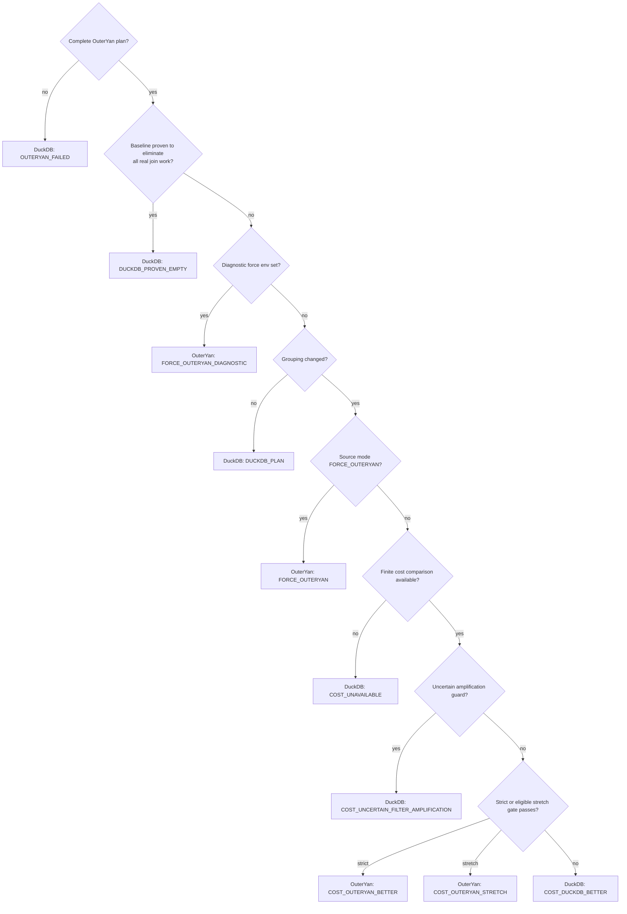
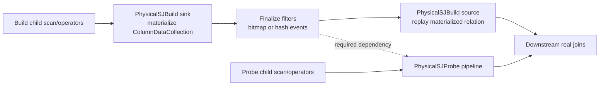

# OuterYan code design and implementation pipeline

This document is a source-derived handoff for a future coding or paper-writing
session. It explains what the current fork actually implements, how the
optimizer and execution layers fit together, which invariants carry the
correctness argument, and which claims still need qualification.

Snapshot used for this document:

- repository: anonymous OuterYan research fork
- inspection date: 2026-09-03
- active selection formula: `OUTER_YAN_COST_V6`

The source code, not older comments or experiment notes, is authoritative. The
section [Implementation status and paper cautions](#16-implementation-status-and-paper-cautions)
records several places where comments describe a broader or older design than
the active code.

## 1. Executive summary

OuterYan is a guarded alternative optimizer for a restricted class of
non-aggregate acyclic equi-join queries containing at least one outer join. It
does not replace DuckDB's optimizer globally. For an applicable query it builds
two candidates from the same post-filter-pushdown logical plan:

1. the normal DuckDB candidate, using DuckDB outer-join simplification and join
   ordering; and
2. an OuterYan candidate, using semantic join-kind normalization, two directed
   semi-join reduction rounds, and a reduction-aware DPccp join-order search.

The candidates are compared by stable base-table grouping and a common
cost model. The selected OuterYan plan is then lowered back to DuckDB logical
operators, decorated with exact semi-join build/probe operators, converted to a
physical plan, and executed with explicit build-before-probe pipeline
dependencies.

The active high-level path is:



The core implementation idea is to separate three concerns:

- **semantic legality:** `Simplification`, `Desimplification`, and
  `Resimplification` make outer-join regrouping safe within the accepted query
  class;
- **physical work reduction:** bottom-up and top-down exact membership filters
  reduce base inputs before the real joins; and
- **risk-controlled selection:** DuckDB's normal plan remains available and is
  chosen for same-grouping, proven-empty, failed, uncertain, or cost-losing
  cases.

## 2. Active scope and non-scope

### 2.1 Accepted by the active facade

The normal `OuterYanOptimizer` path requires all of the following:

- a `SELECT`-style comparison-join skeleton;
- at least one `LEFT`, `RIGHT`, or `FULL` outer join;
- only `INNER`, `LEFT`, `RIGHT`, and `FULL` comparison joins;
- at least one condition on every join;
- equality predicates only;
- each equality side is a plain `BoundColumnRefExpression`;
- each condition references exactly two registered base relations;
- multiple equality keys are allowed only as parallel edges between the same
  relation pair;
- an acyclic relation graph;
- residual predicates reference at most one base relation;
- an intermediate residual inside the join skeleton is provably
  NULL-rejecting;
- base inputs have the shape `Get`, `DummyScan`, or `ExpressionGet`, optionally
  wrapped by unary `Filter` or `Projection` operators; and
- there is no aggregate or `DISTINCT` anywhere in the candidate input.

The last rule is a facade policy in
`src/optimizer/outer_yan/pipeline/outer_yan_optimizer.cpp`, not a limitation of
the applicability visitor alone. The visitor can classify a root aggregate,
but `ContainsAggregateLikeOperator` bypasses OuterYan before that machinery is
entered.

### 2.2 Rejected or bypassed

The active path defers to DuckDB for:

- pure inner-join queries;
- cyclic join graphs;
- cross products;
- non-equality joins and expression-valued equality sides;
- `SEMI`, `ANTI`, `MARK`, `SINGLE`, and other unsupported join kinds;
- `ANY`, delimiter, ASOF, positional, or dependent joins;
- set operations, windows, and aggregation inside the skeleton;
- multi-relation residual filters;
- NULL-tolerant intermediate filters whose evaluation boundary may change;
- every aggregate and `DISTINCT` query; and
- any query for which PostgreSQL plan replay has already taken ownership.

The fallback is intentional: `OuterYanOptimizationResult::outer_yan_applied`
remains false, so `Optimizer::Optimize` runs DuckDB's ordinary
`OuterJoinSimplification` and `JoinOrderOptimizer` path.

## 3. Where OuterYan sits in DuckDB

The integration point is `src/optimizer/optimizer.cpp`, after these important
normalizations:

- expression rewrites;
- filter pullup and filter pushdown;
- CTE filtering/inlining and empty-result pullup;
- window self-join rewriting; and
- projection pullup.

It runs before DuckDB's normal outer-join simplification and join ordering.
When OuterYan handles an applicable query, it runs those two normal passes on
its private baseline copy and tells the outer optimizer loop not to run them a
second time.

After candidate selection, both plans continue through the remaining DuckDB
pipeline, including join elimination, unused-column removal, column-lifetime
analysis, build/probe-side selection, and later physical planning.

The cohesive user-facing switch is:

```sql
SET disabled_optimizers TO 'outer_yan';
```

The internal pass names `outer_yan_pre`, `outer_yan_dp`, `outer_yan_post`, and
`aggregate_pushdown_outer` exist for profiling and targeted tests. Only
`outer_yan_pre` is individually safe to disable. Disabling DP or post after pre
has moved plan ownership into `OuterYanTree` can break the pipeline. Treat the
single `outer_yan` facade as the operational feature flag.

## 4. Core representations and ownership

OuterYan uses two IRs between the DuckDB logical plan and the final rebuilt
plan.

| Representation | Purpose | Shape | Ownership |
|---|---|---|---|
| DuckDB logical plan | Bound query and final executable logical plan | General operator tree | `unique_ptr<LogicalOperator>` |
| Operator Tree (OT) | Binary join grouping and owned join metadata | `JOIN` or `RELATION` nodes | `OuterYanTree::ot` |
| Ordered Join Tree (OJT) | Relation-rooted predicate tree used for directional rules and lowering | relation nodes with parent-to-child edges | `OuterYanTree::ojt` |

### 4.1 `OuterYanTree`

`OuterYanTree` in
`src/include/duckdb/optimizer/outer_yan/common/outer_yan_tree.hpp` is the
per-candidate state carrier. Its important fields are:

- `source_plan`: owns the original candidate logical plan while OT/OJT nodes
  keep raw pointers into base subtrees;
- `ot`: current binary grouping;
- `ojt`: relation-rooted view of the current grouping;
- `table_to_relation`: bound DuckDB `table_index` to local `RelationId`;
- `ot_relations_by_id`: direct relation-node index;
- `ot_joins_by_order`: joins in left-to-right post-order, deepest first;
- `filter_records`: analysis and relocation metadata for residual predicates;
- `bottom_up_pairs` and `top_down_pairs`: immutable reducer schedule recorded
  before synthetic desimplification;
- `agg_pushdown_decisions`: dormant aggregate-pushdown metadata;
- `root_skeleton_parent`: deepest retained cap operator above the join
  skeleton; and
- `stage_stats`: observational counters and selection flags.

The lifetime is deliberately asymmetric:



The original comparison-join operators are not consulted after OT
construction. Each `OTJoin` owns copied conditions, current and original join
kinds, endpoint relation IDs, and edge distinct-count estimates.

### 4.2 Relation identity

Three identifiers must not be confused:

- `RelationId`: compact, candidate-local index assigned while building the OT;
- `TableIndex`: DuckDB binding identity in the logical plan; and
- stable base-table grouping identity: sorted `TableIndex` sets used to compare
  independently constructed candidate and baseline trees.

The cost gate never compares candidate-local `RelationId` values across trees.
`OuterYanDP::JoinGroupingSignature` converts every join subtree to stable
`TableIndex` sets first.

### 4.3 Join-kind orientation

This is the most important structural invariant.

- In a binary OT or logical join, the kind is relative to `children[0]` and
  `children[1]`.
- In the OJT, every edge reads **parent KIND child**.
- If the OJT parent corresponds to the original RHS, `LEFT` and `RIGHT` are
  flipped. `INNER` and `FULL` are unchanged.
- If DP materializes the edge with operands swapped, it flips both
  `join_kind` and `original_join_kind` before storing the new OT node.

The single orientation primitive is `CheckOuterYanJoinFlip`, backed by
`FlipOuterYanJoinKind`, in
`src/include/duckdb/optimizer/outer_yan/common/outer_yan_common.hpp`.

## 5. End-to-end optimizer algorithm

The following pseudocode mirrors
`OuterYanOptimizer::Optimize` rather than an idealized paper algorithm.

```text
OptimizeWithOuterYan(input):
    reject null input
    force_validation := (DUCKDB_OY_FORCE_CANDIDATE == "1")

    candidate_input := unwrap EXPLAIN if present
    if candidate_input contains Aggregate or Distinct:
        return {input, applied = false}
    if not OuterYanApplicability.Check(candidate_input):
        return {input, applied = false}

    baseline_plan := deep_copy(candidate_input)
    candidate_tree := OuterYanPre(candidate_input)
    candidate_cost := OuterYanDP(candidate_tree)

    baseline_plan := DuckDBOuterJoinSimplification(baseline_plan)
    baseline_plan := DuckDBJoinOrderOptimizer(baseline_plan)
    empty_proof := prove_baseline_eliminates_all_real_join_work(baseline_plan)
    baseline_tree := BuildOT(copy(baseline_plan))

    changed := candidate_cost.complete and
               grouping(candidate_tree) != grouping(baseline_tree)

    if candidate_cost.complete:
        score candidate and baseline with the common OuterYan estimator
        if a default-selectivity table filter exists:
            also score both with that relation's unfiltered cardinality
            retain the scenario with the worse candidate/baseline ratio
        compute uncertainty guard and strict/stretch gate

    selected_outeryan := policy(
        complete, empty_proof, force_validation, changed, costs, guards)

    if selected_outeryan:
        selected_plan := OuterYanPost(candidate_tree)
        selected_tree := candidate_tree
    else:
        baseline_tree.BuildOJT()
        baseline_tree.MarkAggPushdown()  // no-op in active non-aggregate path
        selected_plan := baseline_plan
        selected_tree := baseline_tree

    selected_plan := AggregatePushdownOuter(selected_plan, selected_tree)
                     // no-op in the active facade
    verify column bindings
    rewrap EXPLAIN if necessary
    return {selected_plan, applied = true}
```

“Applied” means the facade completely handled both candidates and returned the
winner. It does not mean the OuterYan candidate won. The trace fields
`outer_yan_applied`, `outer_reordered`, and `outer_yan_selected` represent
different facts.

## 6. Applicability analysis

Implementation:

- `src/include/duckdb/optimizer/outer_yan/common/applicability.hpp`
- `src/optimizer/outer_yan/common/applicability.cpp`

### 6.1 Skeleton discovery

`SkeletonRoot` peels unary root `Projection` and `Filter` operators. The
visitor also knows how to peel one root `Aggregate` or `Distinct`, although the
active facade rejects these first. The remaining root must be a
`LogicalComparisonJoin`.

### 6.2 Relation and edge collection

The visitor walks comparison joins top-down but visits the left subtree before
the right subtree. A leaf receives the next dense `RelationId`, and every table
binding returned by `leaf.GetTableIndex()` maps to that relation.

For each ordinary OuterYan join condition:

1. require a comparison;
2. reject `IS DISTINCT FROM` and `IS NOT DISTINCT FROM`;
3. require `=`;
4. require plain column references on both sides;
5. map the references to exactly two relations;
6. insert the undirected relation pair into `seen_pairs`; and
7. union the endpoints in a union-find structure.

The first condition for a relation pair creates the graph edge. Further
conditions between the same pair are compound join keys, not graph cycles. A
new condition whose endpoints are already unioned is rejected as a cycle.

### 6.3 Residual predicates

Every `LogicalFilter` predicate is checked after relation collection:

- at most one relation may be referenced;
- a root predicate stays at its original root scope and is only copied for
  semantic analysis;
- a base-local predicate stays inside its base subtree; and
- an intermediate predicate is accepted only when
  `Simplification::FilterRejectsNulls` proves it NULL-rejecting.

The NULL-rejection proof recognizes comparisons other than distinctness,
`IS NOT NULL`, `IN`/`NOT IN`, `BETWEEN`, default-null-handling scalar
functions, and conjunctions. For `AND`, one rejecting conjunct is sufficient;
for `OR`, every disjunct must reject NULL. Special-null-handling constructs
such as `coalesce` are conservatively rejected.

### 6.4 Applicability pseudocode

```text
Check(plan):
    root := peel_root_caps(plan)
    if root is not ComparisonJoin: reject

    visit(root):
        if ComparisonJoin:
            require supported kind and nonempty conditions
            visit(left); visit(right)
            for each condition:
                require plain two-relation equality
                if first edge for relation pair:
                    require union_find.union(a, b) succeeds
                    record edge(a, b)
        else if Filter inside join skeleton:
            require intermediate expressions to reject NULL
            visit child
        else if forbidden operator:
            reject
        else:
            register as one relation leaf

    require at least one outer join
    require every residual references at most one relation
    accept
```

## 7. Logical plan to Operator Tree

Implementation:

- `OuterYanTree::OTBuilder` in
  `src/optimizer/outer_yan/common/outer_yan_tree.cpp`
- OT validation in `src/optimizer/outer_yan/common/operator_tree.cpp`

### 7.1 Construction

`BuildOT` moves the logical plan into `source_plan` and constructs a binary
tree containing only:

- `RELATION`: raw pointer to an accepted base-relation subtree and a dense
  relation ID; or
- `JOIN`: owned `OTJoin` plus two children.

For a join, all conditions are copied. A post-order walk assigns `order = 1`
to the deepest leftmost join and increases toward the root.

`SetJoinTwoSides` selects the first safe two-relation equality as the anchor,
moves it to `conditions[0]`, and records its two endpoint relations. In the
ordinary OuterYan path every condition already meets that shape; the explicit
anchor search is also used by the separate PostgreSQL replay path.

### 7.2 Filter records and retained cap

`filter_records` preserve two independent facts:

- `referenced_relations`: relations used by the expression; and
- `evaluation_relations`: the complete subtree immediately below the source
  filter.

That distinction prevents a predicate from simplifying an ancestor outside
its original scope. A root filter remains physically in `source_plan`; an
intermediate accepted predicate is moved out of the old filter and later
placed at the first rebuilt subtree covering its relation set.

`root_skeleton_parent` points to the deepest peeled cap immediately above the
join skeleton. During lowering, the rebuilt skeleton is spliced into that
operator's child slot, preserving the complete outer projection/filter cap.

### 7.3 OT finalization invariants

`OperatorTree::Finalize`:

1. recomputes `subtree_relations` bottom-up; and
2. canonicalizes every join so the anchor LHS relation is in child 0 and the
   RHS relation is in child 1, swapping comparison sides but never children or
   join kind.

`OperatorTree::IsValid` checks shape, unique relation IDs, cached subtree sets,
condition/child alignment, and the common-relation rule. The last rule rejects
an implicit cross product when a child join subtree shares no endpoint with
its parent's anchor condition.

## 8. Semantic preprocessing

`OuterYanPre::Optimize` executes this exact order:



Recording reducer pairs before desimplification is essential. Desimplification
introduces synthetic join-kind relabels only to enable regrouping. Reducer
direction must reflect the post-simplification query semantics, not those
synthetic labels.

### 8.1 Simplification

Implementation: `src/optimizer/outer_yan/pipeline/simplification.cpp`.

The pass carries a relation-level `null_rej` set top-down. At each OT node it
activates only filter records whose `evaluation_relations` equal that node's
exact subtree. It then weakens preservation according to which child contains
a null-rejected relation:

| Current kind | LHS null-rejected | RHS null-rejected | New kind |
|---|---:|---:|---|
| `INNER` | any | any | `INNER` |
| `LEFT` | any | yes | `INNER` |
| `LEFT` | any | no | `LEFT` |
| `RIGHT` | yes | any | `INNER` |
| `RIGHT` | no | any | `RIGHT` |
| `FULL` | yes | yes | `INNER` |
| `FULL` | yes | no | `LEFT` |
| `FULL` | no | yes | `RIGHT` |
| `FULL` | no | no | `FULL` |

The possibly simplified join condition then contributes deeper
NULL-rejection facts:

- `INNER`: both endpoint relations;
- `LEFT`: RHS endpoint;
- `RIGHT`: LHS endpoint; and
- `FULL`: neither endpoint.

After the walk, every `original_join_kind` is rebased to the simplified kind.
This is deliberate: resimplification should undo only the later synthetic
desimplification, never reintroduce outerness already eliminated by a valid
predicate proof.

`DUCKDB_OY_SIMPLIFY_SCAN_FILTERS` enables an explicitly unsound experiment
that also seeds null rejection from pushed scan filters. It is off by default
and must not be used as evidence for correctness or paper results.

### 8.2 OJT construction and orientation

`ConstructOJT` converts the predicate graph into a relation-rooted tree. It
chooses a root from the top OT join using the “non-extending side” heuristic,
indexes joins by endpoint, and performs BFS. Each predicate edge attaches when
one endpoint is already present; this handles bushy binary OT shapes without
assuming a spine.

For every attached edge, the builder:

- orients the kind as `parent KIND child`;
- copies the complete `OTJoin` payload;
- detects whether either join-key side covers a `UNIQUE` or primary-key
  constraint;
- independently proves total FK-to-unique coverage in either direction; and
- computes safe reducer-elimination flags after the whole OJT exists.

The total-coverage proof is stronger than uniqueness. It requires an exact,
enforced FK mapping, uniqueness on the referenced key, and declared `NOT NULL`
on every probing FK component.

### 8.3 Two-round reducer schedule

For an OJT edge `parent KIND child`, pair generation is:

| OJT edge kind | Round 1: bottom-up | Round 2: top-down |
|---|---|---|
| `INNER` | build child, probe parent | build parent, probe child |
| `LEFT` | none | build parent, probe child |
| `RIGHT` | build child, probe parent | none |
| `FULL` | none | none |

Equivalently:

```text
Round 1, post-order: parent := parent semijoin child
    emit only for RIGHT or INNER

Round 2, pre-order: child := child semijoin parent
    emit only for LEFT or INNER
```

All equality conditions between the two endpoint relations become ordered
`OuterYanSemiKey` pairs. A semi-join keeps a row exactly when every non-NULL
key component exists in the build set.

The phase boundary is a correctness and scheduling invariant:



`SemijoinInsertion` never coalesces logical SJ operators across the round tag.

### 8.4 Reducer elimination

A bottom-up reducer is removed only when:

- the parent is totally covered by the child through enforced FK/unique and
  non-NULL constraints;
- the child is a terminal OJT leaf;
- the child has no base predicate or pushed table filter; and
- therefore the child's build observes the full referenced key set.

A top-down reducer is removed only when:

- the child is totally covered by the parent;
- the parent has no base predicate;
- the parent has no bottom-up probe from its children; and
- the parent has no top-down probe from its own parent.

These conditions ensure the would-be filter contains the complete guaranteed
key set. A `UNIQUE` marker alone never eliminates a reducer.

### 8.5 Desimplification

Implementation: `src/optimizer/outer_yan/pipeline/desimplification.cpp`.

The pass applies the six Galindo-Legaria/Rosenthal associativity-table rewrites
to ancestor join `P` and descendant join `D` pairs until a fixpoint. It does
not reorder the tree. It changes the lower join kind so subsequent regrouping
falls inside the supported associative state.

For a descendant in `P.children[0]`, use the right-associativity table with
rows `D_low` and columns `D_up`:

| `D_low` \ `D_up` | `INNER` | `LEFT` | `RIGHT` | `FULL` |
|---|---|---|---|---|
| `INNER` | OK | OK | R1: `RIGHT` | R2: `RIGHT` |
| `LEFT` | invalid | OK | invalid | R3: `FULL` |
| `RIGHT` | OK | OK | OK | OK |
| `FULL` | invalid | OK | invalid | OK |

For a descendant in `P.children[1]`, use the left-associativity table with
rows `D_up` and columns `D_low`:

| `D_up` \ `D_low` | `INNER` | `LEFT` | `RIGHT` | `FULL` |
|---|---|---|---|---|
| `INNER` | OK | OK | invalid | invalid |
| `LEFT` | R4: `LEFT` | OK | invalid | invalid |
| `RIGHT` | OK | OK | OK | OK |
| `FULL` | R5: `LEFT` | OK | R6: `FULL` | OK |

The middle relation is the endpoint of `P` that flows into `D`. If it lies on
the noncanonical side of `D`, the code flips `D` only for table lookup and
flips the result back before committing. An invalid table cell throws: the
query was accepted but could not be normalized into the assumed simple-query
class.

## 9. Reduction-aware join-order search

Implementation:

- `src/include/duckdb/optimizer/outer_yan/pipeline/outer_yan_dp.hpp`
- `src/optimizer/outer_yan/pipeline/outer_yan_dp.cpp`

### 9.1 Statistics setup

For each relation, `RelationStatisticsHelper::ExtractGetStats` obtains scan
cardinality and per-column distinct counts. Missing statistics fall back to a
cardinality of one.

For each compound equality edge, per-side distinct counts are multiplied:

```text
D_left(edge)  = product of left-key distinct counts
D_right(edge) = product of right-key distinct counts
D_edge        = max(D_left, D_right, 1)
```

No equivalence-class transitivity is initialized. OuterYan deliberately treats
each condition's columns as private, unlike a transitive inner-join estimator.

### 9.2 Semi-join cardinality and work model

The two recorded pair vectors are simulated in physical order: all bottom-up
pairs, then all top-down pairs. Let `C[r]` be the current cardinality of
relation `r`, initially its estimated scan cardinality. For pair `(B, P)`:

```text
build_scale = min(1, C[B] / base_cardinality[B])
probe_scale = min(1, C[P] / base_cardinality[P])

D_B = 0                                      if C[B] = 0
      max(1, base_build_distinct * build_scale) otherwise

D_P = 0                                      if C[P] = 0
      max(1, base_probe_distinct * probe_scale) otherwise

survival = 0                                 if C[P] = 0 or D_B = 0
           1                                 if D_P = 0 but probe is nonempty
           min(1, D_B / D_P)                 otherwise

C[P] := clamp(C[P] * survival)
```

A unique filter build is keyed by the sorted set of build-side column
bindings. With default unit coefficients, modeled work is:

```text
new filter build work = 3 * C[B]
    = materialize(C[B]) + construct_filter(C[B]) + replay(C[B])

every probe work = C_before[P] + C_after[P]
    = lookup(C_before[P]) + emit(C_after[P])
```

The four totals are retained separately as round-1 build/probe and round-2
build/probe work. They are query-global fixed work and are not charged to DP
leaves, which prevents the same reducer cost from biasing multiple memo
alternatives.

### 9.3 Query graph and enumeration

Each OT join creates a bidirectional `QueryGraphEdges` entry backed by one
`FilterInfo`. The reorderability check in DuckDB's normal enumerator is
intentionally omitted: semantic preprocessing is expected to have made every
accepted edge associative.

Enumeration policy:

- fewer than 12 relations: exact DPccp;
- 12 or more relations: greedy approximate search;
- exact search stops after 10,000 emitted pairs and retries greedily; and
- greedy search refuses cross products and fails if no connected pair exists.

The DP memo keeps the cheapest `DPJoinNode` for every relation set. Singleton
nodes have reduced cardinalities and zero cost. Each connected pair constructs
a candidate using the original edge metadata and stores it only if its cost is
lower than the existing memo entry.

Root-fix modes (`FIX_ALL_OUTPUTS` and `FIX_ONE_OUTPUT`) are implemented for
aggregate/`DISTINCT` anchor relations, with a final unconstrained retry. They
are inactive in the default facade because those queries are bypassed.

### 9.4 Real-join estimator

For logical left and right inputs with cardinalities `L`, `R` and edge-side
distinct estimates `D_L`, `D_R`:

```text
dL = min(L, max(D_L, 1))
dR = min(R, max(D_R, 1))

inner = L * R / max(dL, dR)
unmatched_left  = L * max(0, 1 - min(1, dR / dL))
unmatched_right = R * max(0, 1 - min(1, dL / dR))
```

Output is:

```text
INNER: inner
LEFT:  inner + unmatched_left
RIGHT: inner + unmatched_right
FULL:  inner + unmatched_left + unmatched_right
```

With the current unit weights, local cost equals estimated output and subtree
cost is:

```text
cost(node) = cost(left) + cost(right) + weighted_output(node)
```

The implementation still tracks inner, unmatched-left, and unmatched-right
weights separately so experiments can change their relative contribution.

When an enumeration side does not contain the edge's canonical LHS relation,
the estimator flips `LEFT`/`RIGHT` before applying these formulas. This keeps
the preserved base relation invariant under operand swaps.

### 9.5 Full-reduction lower bound

If every current OT join is `INNER` and each edge has reducer pairs in both
directions, the estimator enforces:

```text
estimated cardinality of subset S >= max reduced leaf cardinality in S
```

The rationale is the Yannakakis full-reduction property: every surviving base
tuple extends to the complete acyclic join. The gate records whether this
correction was necessary and disallows the stretch tier when it was.

### 9.6 Materializing the winning DP tree

`RebuildOT` recursively reconstructs a binary OT from the winning memo entry.
It moves each original `OTJoin` payload exactly once, flips join kinds when DP
swapped operands, runs `OperatorTree::Finalize`, refreshes relation pointers,
and renumbers joins in post-order. `BuildOJT` then produces the final OJT for
postprocessing.

## 10. Baseline construction and final policy

### 10.1 Baseline

The baseline is a deep copy made before `OuterYanPre` mutates or consumes the
candidate input. It receives exactly:

1. DuckDB `OuterJoinSimplification`; and
2. DuckDB `JoinOrderOptimizer`.

A separate proof copy receives statistics propagation and
`EmptyResultPullup`. If the before-plan contains real joins but the proof plan
contains an empty result and no real joins, the baseline is marked
`DUCKDB_PROVEN_EMPTY` and always wins.

### 10.2 Same-grouping rule

Candidate comparison ignores:

- join kind;
- child orientation;
- semi-join wrappers; and
- candidate-local relation IDs.

Each join contributes the sorted stable base-table set under that node. The
collection of those sets is the grouping signature. If the signatures match,
the real DuckDB candidate always wins, even if OuterYan could decorate it with
reducers.

### 10.3 Common cost comparison

The baseline tree is scored with unreduced base cardinalities. The OuterYan
tree is scored with its modeled post-reduction leaf cardinalities. Both use the
same join-kind-aware estimator and row-work coefficients.

The gate input is:

```text
semijoin_raw_cost = R1_build + R1_probe + R2_build + R2_probe
weighted_semijoin_cost = 1.0 * semijoin_raw_cost
candidate_total = candidate_join_cost + weighted_semijoin_cost
strict_threshold = 1.0 * baseline_cost
```

The strict tier selects OuterYan when:

```text
candidate_total <= baseline_cost
```

### 10.4 Uncertainty handling

If DuckDB used its generic table-filter selectivity for either tree, both trees
are also rescored with the affected relation's unfiltered base cardinality.
The gate retains whichever scenario has the worse candidate/baseline ratio.

A separate uncertain-filter amplification guard rejects the candidate when:

```text
semi-join retained-cardinality ratio >= 0.99
and
largest input / smallest uncertain base relation >= 1000
```

### 10.5 Confidence-aware stretch tier

If the candidate loses the strict tier, it may use a `1.20 * baseline_cost`
ceiling only when all of these hold:

- no default-filter upper-bound scenario was checked;
- no uncertain-filter amplification guard is active;
- no full-reduction lower-bound correction was applied;
- `candidate_join_cost < baseline_cost`;
- `candidate_join_input_rows / baseline_join_input_rows <= 0.75`; and
- semi-join retained-cardinality ratio is at least `0.95`.

The high retention requirement means this tier is intended for candidates
whose win comes primarily from regrouping rather than an uncertain large
reduction estimate.

### 10.6 Decision precedence



The source-level selection mode and cost constants are in
`src/include/duckdb/optimizer/outer_yan/pipeline/outer_yan_optimizer.hpp`.
They are compile-time experiment policy, not SQL variables.

`DUCKDB_OY_FORCE_CANDIDATE=1` is a diagnostic correctness override. It bypasses
same-grouping and cost selection only after a complete candidate exists and the
baseline is not proven empty. It does not make inapplicable or aggregate
queries eligible.

## 11. OJT postprocessing and logical semi-join insertion

### 11.1 Resimplification

Implementation: `src/optimizer/outer_yan/pipeline/resimplification.cpp`.

After DP, resimplification tries to restore a synthetically changed edge to
its post-simplification `original_kind`. For changed edge `i`, it looks for a
directly adjacent edge `k` such that:

- `k.order > i.order`; and
- the preservation arrow of `k` points toward the node shared with `i`.

Arrow direction uses OJT orientation:

- `LEFT`: toward child;
- `RIGHT`: toward parent;
- `FULL`: toward both; and
- `INNER`: toward neither.

Edges are processed by ascending order to a fixpoint. This is the inverse
semantic cleanup after the chosen evaluation order is known.

### 11.2 OJT to logical plan

`OJTToLogicalPlan` first copies every base subtree into a memo keyed by
singleton relation sets. Edges are sorted by `order`, and each edge merges its
current parent and child sets into a new `LogicalComparisonJoin`.

Conditions are swapped when needed so their expression sides align with the
new child order. The edge kind is already in parent/child orientation.
Relocatable filters are attached to the first rebuilt subtree covering their
relations; retained root filters remain in the original cap. Finally the cap
is spliced back above the rebuilt skeleton.

### 11.3 Building the logical SJ nest

Implementation:

- `src/include/duckdb/optimizer/outer_yan/semi_join/semijoin_insertion.hpp`
- `src/optimizer/outer_yan/semi_join/semijoin_insertion.cpp`

Pairs are processed in hard schedule order: all bottom-up pairs, then all
top-down pairs. For every pair:

1. sort `(build_binding, probe_binding)` key pairs by build binding;
2. use the sorted build-binding vector as the filter-sharing key;
3. create one `SemiJoinFilter` and one stable plan-local `filter_id` on the
   first occurrence;
4. append a logical build wrapper to the build relation's stack;
5. append a logical probe wrapper to the probe relation's stack; and
6. record the producing build on the probe.

Adjacent operators coalesce only when they have the same kind and round tag.
A build followed by a probe, or any cross-round boundary, opens another nest
level. This preserves schedules such as `probe -> build -> probe` on one base
relation.

The plan is then walked to each base unit. A `Filter -> Get` pair is treated as
atomic, and the SJ nest is placed above the filter so a build sees post-filter
rows. Column bindings are resolved to positional child-column IDs at splice
time.

Example shape for one relation participating in several reductions:

```text
outermost
  LogicalSJBuild(round 2, possibly multiple filters)
    LogicalSJProbe(round 2, possibly multiple filters)
      LogicalSJBuild(round 1, possibly multiple filters)
        LogicalSJProbe(round 1, possibly multiple filters)
          LogicalFilter
            LogicalGet
innermost
```

The exact stack depends on pair order and edge kinds; absent stages disappear.

### 11.4 Durable filter identity

Logical build and probe nodes initially share `shared_ptr<SemiJoinFilter>`
objects and raw build back-pointers. Neither identity is trusted across logical
plan copy or serialization. Each filter therefore also has a stable integer
ID.

During physical planning:

- `GetOrCreateSJFilter(id)` returns one runtime filter per physical plan;
- every physical build registers itself in `sj_build_by_id`; and
- after the whole plan is built, `LinkSemiJoinProbes` resolves every probe's
  IDs to the actual physical build operators.

This makes statement verification, plan copying, and serialization independent
of raw pointer identity.

## 12. Physical execution design

Implementation:

- `src/execution/physical_plan/plan_sj_build.cpp`
- `src/execution/physical_plan/plan_sj_probe.cpp`
- `src/execution/operator/join/physical_sj_build.cpp`
- `src/execution/operator/join/physical_sj_probe.cpp`
- `src/optimizer/outer_yan/semi_join/semi_join_filter.cpp`
- `src/optimizer/outer_yan/semi_join/key_bitmap.cpp`
- `src/optimizer/outer_yan/semi_join/hash_filter.cpp`

### 12.1 Physical operator roles

`PhysicalSJBuild` is both sink and source:

- as a sink, it materializes input chunks and finalizes one or more exact
  membership filters; and
- as a source, it replays the materialized rows so the enclosing logical data
  path still receives the relation.

`PhysicalSJProbe` is a schema-preserving, parallel middle operator. It applies
every attached filter in order and intersects their survivors through a
`SelectionVector`.

### 12.2 Pipeline dependency



`PhysicalSJProbe::BuildPipelines` asks every related build to construct or
reuse its child meta-pipeline. The current probe pipeline depends on the
build's `this_pipeline`. Therefore filter finalization happens-before the first
probe row. Encountering `SemiJoinFilter::UNDECIDED` during probe is a hard
internal error, not a pass-through fallback.

This dependency must remain explicit through `MetaPipeline`. Tree position
alone is not a scheduling guarantee.

### 12.3 Build sink and replay source

Each sink thread appends chunks to a local `ColumnDataCollection`. `Combine`
moves those local collections into the global state under a mutex. `Finalize`
merges them into one collection, chooses a kernel independently for every
filter, and schedules any parallel construction events.

The source side performs a parallel scan of the same global collection. A
semi-join build therefore has the modeled three kinds of row work:
materialization, filter construction, and replay.

### 12.4 Bitmap kernel

`KeyBitmap` is an exact bit-per-value set for a single key column. The active
eligible logical types are:

- `INTEGER`;
- `BIGINT`;
- `UINTEGER`; and
- `DATE`.

Build proceeds in two parallel event stages:

1. scan disjoint chunk ranges for local min/max and non-NULL counts;
2. reduce the range, allocate a 64-byte-aligned bitmap, and fill bits with
   relaxed atomic OR operations.

The payload needs one bit for each integer in inclusive range `[min, max]`.
If that range exceeds the per-filter byte budget, construction falls back to a
hash filter. An empty or all-NULL build produces an empty bitmap and rejects
every probe row.

Probe converts the vector to `UnifiedVectorFormat`, derives validity and
in-range masks, gathers bitmap words, and writes surviving row indices to a
selection vector. NULL probe keys never match.

### 12.5 Hash kernel

`HashFilter` is an exact open-addressed set with linear probing and a maximum
load factor of 0.75 for dynamically grown tables.

It has two storage modes:

- `INLINE_64`: single signed/unsigned integer key stored directly beside its
  hash, with a separate occupancy bitmap; and
- `BOXED`: general `vector<Value>` tuples for strings, decimals, composite
  keys, and other types.

The physical build pre-sizes eligible `INLINE_64` filters to at most 0.5 load
under the input-row upper bound and inserts chunks in parallel. Occupancy-bit
atomic claims give each slot one writer. Boxed filters are currently built
sequentially from the materialized global collection.

The default hash is DuckDB's vectorized hash/`CombineHash` sequence. Optional
MurmurHash64A uses a scalar per-row fallback. Probe hashes whole chunks once
when the DuckDB hash is selected. `INLINE_64` avoids per-row `Value`
materialization; `BOXED` reuses one key vector but materializes its component
values per row.

Both filter implementations are exact: there are no Bloom-filter false
positives. Duplicate build keys collapse to set membership, and any NULL key
tuple is skipped.

### 12.6 Runtime kernel choice

Per filter, `PhysicalSJBuild::Finalize` applies:

```text
if ForceHash hint or bitmap-ineligible key or bitmap budget == 0:
    use parallel INLINE_64 hash when eligible
    otherwise use sequential BOXED hash
else:
    scan bitmap range
    if range fits budget:
        build bitmap
    else:
        build INLINE_64 hash fallback
```

Controls:

| Control | Default | Meaning |
|---|---:|---|
| `outer_yan_bitmap_max_bytes` | 32 GiB per filter | Bitmap payload budget; zero forces hash |
| `outer_yan_hash_fn` | `duckdb` | `duckdb` or `murmur` hash |
| `outer_yan_stats_prefilter` | `false` | Use base min/max to pre-mark likely bitmap overflow as `ForceHash` |
| `DUCKDB_SJ_KERNEL_TRACE` | unset | Emit the finalized kernel and hash-fallback reason |

The stats prefilter is optional because base-table min/max can overestimate the
post-filter range. Runtime min/max and allocation remain the final kernel
decision.

## 13. Aggregate-pushdown subsystem: implemented but inactive

Files:

- `src/optimizer/outer_yan/pipeline/agg_pushdown.cpp`
- `src/optimizer/outer_yan/pipeline/aggregate_pushdown_outer.cpp`

The IR and passes retain an experimental aggregate design:

1. `BuildOT` classifies root aggregation as `COUNT_STAR`, `MINMAX`, `SUM`,
   `SELECT_DISTINCT`, `OTHER`, or `NONE`.
2. group-by or distinct columns can anchor DP root position.
3. `AggPushdown` marks non-PK/FK OJT child edges as candidate push sites.
4. `AggregatePushdownOuter` speculatively inserts child aggregation on a plan
   copy, prunes unused columns, disables sites with more than two surviving
   groups, and then applies refined decisions to the real plan.

However, the active `OuterYanOptimizer` bypasses every query containing an
aggregate or `DISTINCT`. Even if this facade guard is removed, the current
`AggregatePushdownOuter::Optimize` executes a real push only for grouped
`COUNT(*)`. Group-less `COUNT(*)`, `SUM`, `MIN/MAX`, and `DISTINCT` return
unchanged due remaining correctness or verification/type-fidelity issues.

Therefore a paper describing the current evaluated system should say:

> Aggregate-aware IR and pushdown prototypes exist, but aggregate and DISTINCT
> queries are routed to DuckDB in the active experimental policy.

It should not claim aggregate pushdown as an active OuterYan optimization
without a later code change and new end-to-end evidence.

## 14. Correctness invariants

The following invariants are the shortest checklist for future changes.

1. **Accepted graph is acyclic and connected through real predicates.** Never
   introduce a DP cross product.
2. **Join kind is orientation-relative.** Flip `LEFT`/`RIGHT` whenever operands
   swap; preserve `INNER`/`FULL`.
3. **Post-simplification kind is the semantic baseline.** Desimplification may
   synthesize kinds; resimplification may only revert to that rebased value.
4. **Reducer pairs precede desimplification.** Their direction encodes query
   semantics, not associativity scaffolding.
5. **Bottom-up completes before top-down.** Do not coalesce operators or
   pipelines across this phase boundary.
6. **A probe depends on every producer build.** Filter publication happens at
   build finalization, and `UNDECIDED` at probe time is an error.
7. **Stable filter IDs are authoritative across plan copies.** Raw pointers and
   logical shared-pointer identity are conveniences only.
8. **Filters are exact and NULLs never match.** Any new SIMD path must preserve
   the scalar fallback and SQL semi-join NULL behavior.
9. **Residual filter scope is explicit.** Root predicates stay at the root;
   relocated predicates must be justified by NULL rejection and coverage.
10. **Same grouping selects the real DuckDB candidate.** Do not substitute an
    OuterYan reconstruction for an equivalent grouping.
11. **A proven-empty baseline wins.** Avoid reducer materialization when normal
    statistics propagation removes all real join work.
12. **Correctness experiments execute the bare query.** CTAS, `COPY`, or
    `LIMIT` can change the optimized plan and hide defects.

## 15. Complexity and resource behavior

These are implementation-level bounds, not formal theoretical claims.

- Applicability and OT/OJT construction are linear in the plan and predicate
  graph aside from expression walks, catalog constraint inspection, and the
  simplifier's repeated scan of filter records.
- Desimplification examines ancestor/descendant join pairs on each fixpoint
  pass. Treat it as `iterations * O(J^2)` rather than claiming linear time.
- Exact DPccp is exponential in the worst case but is restricted to fewer than
  12 relations and capped at 10,000 emitted pairs.
- Greedy fallback repeatedly scans connected live-set pairs and is roughly
  cubic in the relation count in the straightforward implementation.
- Every physical SJ build materializes its input. Coalesced filters share that
  materialization, but distinct build nest levels materialize separately.
- Bitmap construction scans build data for min/max and again for bit filling;
  memory is proportional to the numeric key range, not the number of keys.
- Hash memory is proportional to distinct build-key count; general boxed keys
  also retain `Value` tuples.
- Probe work is linear in input rows times attached filters, with survivors
  compacted between filters.

## 16. Implementation status and paper cautions

### 16.1 Active, tested behavior

- non-aggregate acyclic outer/equi-join applicability and fallback;
- scoped NULL-rejection simplification;
- six-rule desimplification and post-DP resimplification;
- DPccp plus greedy fallback and join-kind-aware costs;
- stable grouping comparison and V6 candidate gate;
- two-round logical SJ insertion;
- explicit physical build/probe dependencies;
- exact bitmap and hash kernels;
- PK/FK-based reducer elimination with total-coverage checks; and
- bare-query ON/OFF result comparison harnesses.

### 16.2 Dormant or incomplete behavior

- aggregate and `DISTINCT` optimization is bypassed by the facade;
- only grouped `COUNT(*)` reaches the active rewrite body if called directly;
- bitmap composite keys are unsupported;
- boxed hash construction is sequential;
- `OrderedJoinTree::PostOrder` throws `NotImplementedException`;
- no temporary-memory-manager integration exists for materialized SJ builds;
  and
- ordinary OuterYan rejects theta predicates and expression-valued equality
  sides. The separate PostgreSQL replay path has a broader anchored-predicate
  policy and should not be cited as ordinary OuterYan support.

### 16.3 Source/comment drift to avoid copying into a paper

The following facts come from executable branches and supersede nearby stale
comments:

- `KeyBitmap` code accepts `INTEGER`, `BIGINT`, `UINTEGER`, and `DATE`; it does
  **not** accept `UBIGINT` despite one header overview listing it.
- `SemijoinInsertion` does **not** pin every filter to hash. It optionally sets
  `ForceHash`, while runtime finalization normally tries bitmap first.
- parallel `INLINE_64` hash build is implemented even though an older comment
  around physical finalization says parallel hash is deferred.
- aggregate pushdown headers describe multiple aggregate families, but the
  active facade bypasses all of them and the internal implementation currently
  performs the rewrite only for grouped `COUNT(*)`.

### 16.4 Cross-round filter sharing caveat

Filter sharing is keyed only by the sorted build-side binding set and the map
persists across both rounds. This is efficient when multiple probes need the
same build key set. A consequence inferred from the current schedule is that a
round-2 request can reuse a filter built in round 1 even if that relation was
further reduced in between. The older filter is a key-set superset, so reuse is
safe for final query correctness but can retain more rows than a freshly built
round-2 filter.

This matters for two paper claims:

- call the implementation a two-round exact-filter reduction schedule, but do
  not claim every physical input is necessarily fully reduced unless this
  sharing case is ruled out or measured; and
- the cost model charges no rebuild for a reused filter but estimates survival
  from the current reduced build distinct count, which can be more optimistic
  than probing the older physical filter.

A refinement can either make the sharing key include build-state/round, or
retain reuse and model its actual earlier key set.

### 16.5 DATE overflow-path debug assertion

`DATE` is bitmap-eligible. If its range exceeds the bitmap budget,
`SJBuildBitmapInitEvent` routes to the parallel inline hash event. The code
asserts that the logical type is `HashFilter::IsInline64Eligible`, but that
function intentionally excludes `DATE` even though `ReserveInline` later
accepts its physical `INT32` representation. In a debug build the assertion can
fire on a DATE bitmap-overflow fallback; release builds continue.

Before publishing comprehensive DATE-key results, align the eligibility checks
and add a focused overflow-path test.

### 16.6 Applicability/build mismatch for opaque leaves

The applicability visitor's default branch can register an arbitrary opaque
leaf such as a CTE reference, but `OTBuilder::BuildNode` accepts only the
`IsBaseRelationSubtree` forms plus explicit join/root-cap operators. An opaque
leaf may therefore pass the visitor and fail during OT construction.

The active paper scope should use concrete base-relation subtrees. A code
refinement should make the visitor and builder share one leaf predicate.

## 17. Testing and diagnosis

### 17.1 Focused build and unit tests

```bash
GEN=ninja make debug
build/debug/test/unittest "[outer_yan]"
```

The current workspace also has a release build, which should be used for
performance conclusions. Debug timings are directional only.

Focused C++ coverage lives under `test/optimizer/outer_yan/`:

| Test file | Main responsibility |
|---|---|
| `applicability_test.cpp` | accepted/rejected shapes and graph metadata |
| `passes_integration_test.cpp` | OT/OJT invariants, transformations, policy, equivalence |
| `key_bitmap_test.cpp` | types, ranges, budgets, NULLs, batch probing |
| `hash_filter_test.cpp` | boxed/inline sets, hashing, merging, kernels |
| `semi_join_filter_test.cpp` | tagged-filter lifecycle |
| `sj_operator_bench.cpp` | operator plan shape, parity, microbenchmarks |
| `postgres_plan_replay_test.cpp` | separate replay subsystem |

SQL coverage lives under `test/sql/optimizer/outer_yan/`, especially:

- `acyclic_query.test` and `fallback.test`;
- `outer_join_chain.test`;
- `semijoin_passes.test`;
- `bitmap_budget.test`;
- `feature_flag.test`;
- `graph_complex_query.test`; and
- full-output TPC-H/TPC-DS/graph result-equivalence tests.

### 17.2 Bare-query corpus validation

Start small:

```bash
bash auto_test/experiment_onoff.sh --only graph --limit 5 --capture-plans
```

The harness first compares the complete result multiset with OuterYan OFF and
ON, then records candidate decision, runtime kernel, phase profile, and timing.
Incorrect, crashing, or timed-out queries are not timed as wins.

OFF and ON mean:

```sql
-- OFF
SET disabled_optimizers TO 'outer_yan';

-- ON
SET disabled_optimizers TO '';
```

### 17.3 Diagnostics

```text
PRAGMA enable_verification
PRAGMA verify_parallelism
PRAGMA explain_output='all'
DUCKDB_OYTRACE=/path/to/trace.txt
DUCKDB_SJ_KERNEL_TRACE=1
```

For one query:

```bash
bash auto_test/trace_outer_yan.sh \
  -b build/release/duckdb \
  --db /path/to/database.duckdb \
  -f /path/to/query.sql
```

The trace stage order is:

```text
input logical plan
after BuildOT
after Simplify
semi-join pair lists
after Desimplify
after DP
DuckDB baseline
baseline empty-result proof
candidate/baseline cost detail
final decision
after Resimplify (selected OuterYan only)
after logical SJ insertion (selected OuterYan only)
after aggregate pushdown (currently a no-op in active path)
```

## 18. Source map for a future session

### Optimizer control and IR

| File | Role |
|---|---|
| `src/optimizer/optimizer.cpp` | global dispatch and fallback boundary |
| `src/optimizer/outer_yan/pipeline/outer_yan_optimizer.cpp` | two-candidate facade and final policy |
| `src/include/duckdb/optimizer/outer_yan/common/outer_yan_common.hpp` | shared enums, filter/pair metadata, orientation helpers |
| `src/include/duckdb/optimizer/outer_yan/common/outer_yan_tree.hpp` | ownership and pipeline state |
| `src/optimizer/outer_yan/common/outer_yan_tree.cpp` | plan/OT/OJT conversions, PK/FK proofs, lowering |
| `src/optimizer/outer_yan/common/operator_tree.cpp` | OT canonicalization and invariants |
| `src/optimizer/outer_yan/common/ordered_join_tree.cpp` | OJT printing and diagnostics |

### Algorithm passes

| File | Role |
|---|---|
| `src/optimizer/outer_yan/common/applicability.cpp` | restricted-query gate |
| `src/optimizer/outer_yan/pipeline/outer_yan_pre.cpp` | preprocess driver and pair recording |
| `src/optimizer/outer_yan/pipeline/simplification.cpp` | scoped NULL-rejection collapse |
| `src/optimizer/outer_yan/pipeline/desimplification.cpp` | associativity-table fixpoint |
| `src/optimizer/outer_yan/pipeline/outer_yan_dp.cpp` | reducer estimates, DPccp/greedy, costs, OT rebuild |
| `src/optimizer/outer_yan/pipeline/resimplification.cpp` | post-DP semantic kind restoration |
| `src/optimizer/outer_yan/pipeline/outer_yan_post.cpp` | OJT lowering and SJ insertion driver |
| `src/optimizer/outer_yan/semi_join/semijoin_insertion.cpp` | logical SJ schedule realization |

### Runtime

| File | Role |
|---|---|
| `src/planner/operator/logical_sj_build.cpp` | logical build node and serialization metadata |
| `src/planner/operator/logical_sj_probe.cpp` | logical probe node and build references |
| `src/execution/physical_plan/plan_sj_build.cpp` | logical-to-physical build lowering |
| `src/execution/physical_plan/plan_sj_probe.cpp` | logical-to-physical probe lowering |
| `src/execution/physical_plan_generator.cpp` | filter registry and final build/probe linking |
| `src/execution/operator/join/physical_sj_build.cpp` | materialize, construct filter, replay, pipeline source/sink |
| `src/execution/operator/join/physical_sj_probe.cpp` | selection-vector filtering and dependencies |
| `src/optimizer/outer_yan/semi_join/key_bitmap.cpp` | dense exact integer/date membership |
| `src/optimizer/outer_yan/semi_join/hash_filter.cpp` | exact inline/boxed hash membership |
| `src/optimizer/outer_yan/semi_join/semi_join_filter.cpp` | one-time bitmap/hash tagged carrier |

Adding `LOGICAL_SJ_BUILD`, `LOGICAL_SJ_PROBE`, `SJ_BUILD`, or `SJ_PROBE` touches
logical/physical operator enums and serialization-visible plan structure. Treat
any further enum changes as compatibility changes.

## 19. Guidance for refining the paper

### 19.1 Safe claims from the present code

The implementation supports evidence for these statements:

- OuterYan searches alternative groupings for a restricted acyclic outer-join
  class after explicit semantic normalization.
- It derives directed semi-join reducers from preserved/null-supplying edge
  orientation and schedules bottom-up before top-down.
- Its filters are exact bitmap or hash membership structures, not probabilistic
  Bloom filters.
- Its DP sees modeled reduced leaf cardinalities and uses a join-kind-aware
  unmatched-row estimator.
- It compares against DuckDB's actual normally optimized candidate from the
  same logical input and can decline its own candidate.
- Plan selection includes same-grouping, proven-empty, uncertainty, and
  confidence-aware cost guards.
- Runtime probes have explicit dependencies on completed filter builds.

### 19.2 Claims that require qualification or more work

Avoid an unqualified statement that:

- OuterYan handles cyclic queries, theta joins, arbitrary expressions, or
  arbitrary subqueries;
- aggregate pushdown is active in the evaluated optimizer;
- every accepted plan is selected;
- the cost model is DuckDB's stock cost model;
- the reducer is always physically fully reduced despite cross-round filter
  reuse;
- bitmap memory depends on build cardinality rather than key-domain width;
- all filter construction is parallel; or
- correctness is established by wrapped CTAS/COPY measurements.

### 19.3 Suggested paper-to-code organization

An implementation section can follow this order:

1. **Applicability and semantic IR.** Define accepted acyclic equi-join trees,
   relation identity, and child-relative join kinds.
2. **Semantic normalization.** Present scoped NULL-rejection simplification,
   associativity-table desimplification, and post-order resimplification.
3. **Two-round reduction.** Give the edge-kind direction table, elimination
   proof conditions, and exact filter implementations.
4. **Reduction-aware enumeration.** Present reducer cardinality propagation,
   DPccp/greedy boundary, join formulas, and operand-orientation handling.
5. **Guarded candidate selection.** Define the DuckDB baseline, grouping
   equality shortcut, V6 cost equation, uncertainty checks, and stretch tier.
6. **Pipeline realization.** Explain sink/source materialization, stable filter
   IDs, and build-before-probe meta-pipeline dependencies.
7. **Experimental protocol.** State bare-query multiset equivalence first,
   release-build performance second, and distinguish selected candidates from
   merely constructed candidates.

### 19.4 Evidence fields worth carrying into results

For every query, retain at least:

- applicability/fallback reason;
- `outer_reordered`;
- selected plan and reason;
- candidate and baseline join groupings;
- `baseline_cost`, `candidate_join_cost`, and `semijoin_raw_cost`;
- strict versus stretch gate and all confidence guards;
- round-1/round-2 pair and distinct filter counts;
- realized bitmap/hash kernel mix and fallback reasons;
- result equivalence;
- single-thread and multi-thread latency; and
- whether the candidate was forced only for diagnostic evaluation.

This separation prevents three common interpretation errors: counting a
constructed but rejected plan as an OuterYan runtime result, attributing a
same-grouping DuckDB plan to OuterYan, and presenting aggregate-query behavior
as evidence for a currently bypassed subsystem.
